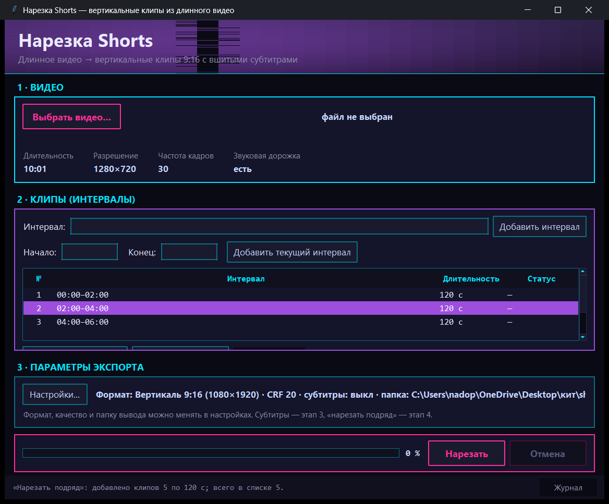
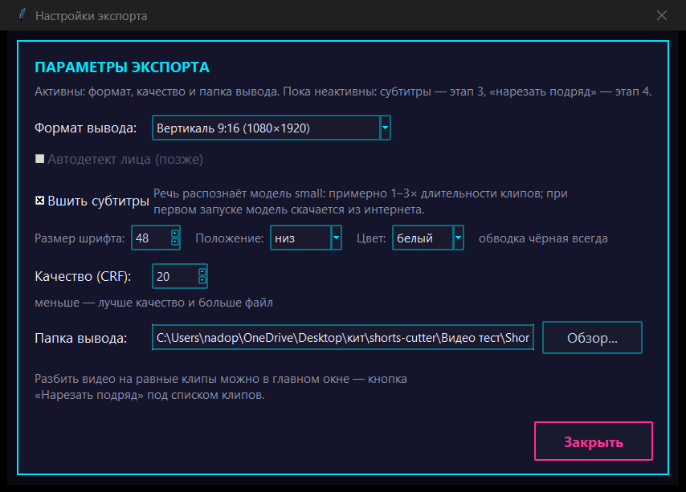
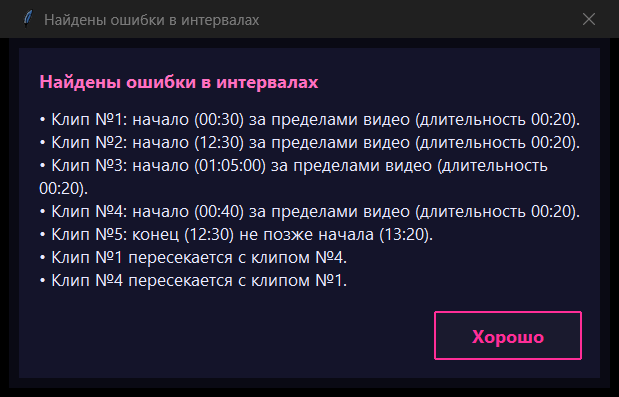

# Нарезка Shorts — этапы 1–4 (каркас, нарезка, субтитры, удобства)

Десктопное приложение для Windows, которое режет длинное видео на вертикальные
клипы 9:16 с субтитрами. Этот каталог — реализация **всех четырёх этапов** по ТЗ
(копия ТЗ лежит в `tasks/spec.md`): окно и разметка интервалов, нарезка через
ffmpeg с кропом в 9:16, прогрессом и отменой, субтитры через `faster-whisper`
с вшиванием в клип, а также «нарезать подряд», открытие папки и суффиксы имён.

## Запуск

Один файл, двойной клик:

```bat
Нарезка Shorts.cmd
```

Внутри него лежит всё приложение: при первом запуске он распаковывает его в папку
`_app` рядом с собой и запускает установленным Python. Нужен Python 3.11+; если
рядом есть `.venv` проекта, доступны и субтитры — подробности в разделе о
лаунчере ниже.

Классический запуск из исходников:

```bat
ЗАПУСК.bat
```

Файл сам выбирает интерпретатор по порядку: окружение проекта `.venv`, затем
системный Python через launcher `py`, затем `python` из PATH. Зависимости
(`imageio-ffmpeg` с ffmpeg внутри) ставятся один раз и требуют интернета.

Вручную то же самое:

```bat
.venv\Scripts\python.exe main.py
```

или на системном Python (`python` в PATH — сломанная заглушка, поэтому именно `py`):

```bat
py -3 -m pip install -r requirements.txt
py -3 main.py
```

Требуется Python 3.11+ с компонентом Tkinter. Права администратора не нужны.

> `ЗАПУСК.bat` сохранён в кодировке **cp866** — так его правильно читает cmd.exe.
> Не пересохраняйте файл в UTF-8: cmd тогда ломает разбор строк (кириллица в
> UTF-8 «съедает» первые буквы команд).

## Окружение на этом компьютере

| Что | Где | Состояние |
| --- | --- | --- |
| Python 3.15.2 + Tkinter **Tk 9.0**, pip 26.2.2 | `%LOCALAPPDATA%\Python\pythoncore-3.15-64` (запуск: `py -3`) | рабочий, `imageio-ffmpeg` 0.8.1 есть, `faster-whisper` поставить нельзя (см. ниже) |
| Python 3.12.14 + Tkinter 8.6, pip 26.3 | `.venv` в проекте (~108 МБ) | рабочий, `imageio-ffmpeg` 0.8.1 **и `faster-whisper` 1.2.1** |
| Модель `small` (файлы 464 МБ) | `.hf-cache\faster-whisper-small` | уже скачана, приложение берёт её офлайн |

**Субтитры работают через `.venv`** — это и есть причина, по которой `ЗАПУСК.bat`
сначала ищет окружение проекта. Для системного Python 3.15 установка
`faster-whisper` пока невозможна: на PyPI ещё нет готовых колёс `av` и
`onnxruntime` под cp315 (проверено запросом к PyPI: у `av 19.0.2` есть колесо под
cp312 и ни одного под cp315, у `onnxruntime 1.32.0` то же), а сборка из исходников
на этой машине падает — поэтому их придётся подождать.

Приложение проверено на **обоих** интерпретаторах: 87/87 юнит-тестов на каждом,
59/59 проверок окна на 3.15 (субтитры отключены) и 56/56 на 3.12 (субтитры
доступны — проверяется их включение).

Если удалить `.venv`, приложение продолжит работать на `py -3`, но субтитры будут
недоступны, пока для Python 3.15 не появятся колёса. Модель в `.hf-cache` (464 МБ)
тоже можно удалить — тогда она скачается заново при первом включении субтитров.

Системный Python появился так: `python` и `py` в PATH оказались заглушкой
**Python Manager** (сначала падал с `This runtime has been lost due to an error`),
а официальный установщик `python-3.13.9-amd64.exe` блокируется политикой Windows
(AppLocker и Smart App Control, `VerifiedAndReputablePolicyState=1`, отказ в
запуске с кодом 5). Помогло обновление рантайма самого менеджера: `py install`
поставил Python 3.15.2 в `%LOCALAPPDATA%\Python`, и `py -3` заработал.

## Один файл для запуска: `Нарезка Shorts.cmd`

Если нужен **один файл, который запускается двойным кликом** — это
[Нарезка Shorts.cmd](Нарезка%20Shorts.cmd) (130 КБ). Внутри него лежит zip со всем
приложением, поэтому рядом ничего не требуется: при первом запуске он распаковывает
приложение в папку `_app` рядом с собой и запускает установленным Python.

- Нужен установленный Python 3.11+ (у вас он есть: `py -3` даёт Python 3.15.2).
- Если рядом лежит `.venv` проекта, лаунчер берёт Python из него — тогда доступны
  **субтитры** (модель подхватывается из `.hf-cache`). Без `.venv` приложение
  работает полностью, кроме распознавания речи, и честно пишет об этом.
- Файл можно унести в другую папку: он распакуется там же и запустится на
  системном Python.
- Пересобрать после правки исходников: `.venv\Scripts\python.exe make_launcher.py`
  (внутри файла хранится отпечаток сборки, поэтому при изменении приложения
  папка `_app` обновляется сама).
- Проверка без открытия окна: `"Нарезка Shorts.cmd" --check` — отчёт печатается и
  дублируется в `_app\shorts_cutter.log`.

### Почему не .exe

`dist\Нарезка Shorts.exe` собирается и по составу верен (внутри tkinter, Tcl/Tk и
ffmpeg), но **на этом компьютере не запускается**: включён **Smart App Control**, и
журнал CodeIntegrity прямо говорит, почему:

```
Code Integrity determined that a process (...) attempted to load
...\dist\Нарезка Shorts.exe that did not meet the Enterprise signing level
requirements or violated code integrity policy (Policy ID:{0283ac0f-...})
```

Политика требует подписанную программу, а свежесобранный файл не подписан —
блокировка не зависит от того, кто его запускает: и моя попытка, и запуск через
проводник отклонены. Командный файл (`Нарезка Shorts.cmd`) этой политикой не
затрагивается — он обычный текст, поэтому и стал «одним рабочим файлом» здесь.

Варианты, если нужен именно .exe:

1. **Выключить Smart App Control** (Windows Security → App & browser control →
   Smart App Control → Off). Учтите: обратно он включается только переустановкой
   или сбросом Windows. Это решение только ваше — приложение от этого не зависит.
2. **Собрать .exe в облаке GitHub** — на вашем компьютере не собирается и не
   блокируется: сборка идёт на виртуальной машине GitHub, готовый файл
   скачивается ссылкой. Пошагово: [КАК-СОБРАТЬ-EXE-НА-GITHUB.md](КАК-СОБРАТЬ-EXE-НА-GITHUB.md).
   Готовый workflow — `.github/workflows/build-exe.yml`.
3. Собрать .exe на компьютере без Smart App Control: скопировать проект и
   запустить `build_exe.py` — готовый файл появится в `dist`.
4. Подписать .exe сертификатом подписи кода (нужен настоящий сертификат, не
   самоподписанный).

## Полноценное приложение: иконка, настройки, установщик

Что добавлено для «взрослого» вида приложения:

- **Иконка** (`assets/icon.ico`, рисуется скриптом `make_icon.py`) — она же
  ставится окну приложения, попадает в `.exe` и в графику Store.
- **Метаданные файла**: имя, издатель, версия, авторские права и язык
  (`appconfig.py` + ресурс версии в `build_exe.py`).
- **Настройки сохраняются между запусками** в
  `%APPDATA%\ShortsCutter\settings.json`: формат, качество, папка вывода,
  субтитры и их оформление, длина клипа, число моментов, последняя папка,
  размер и положение окна. Файл пишется «через замену», повреждённый файл не
  мешает запуску (берутся значения по умолчанию).
- **Прогресс в панели задач Windows** во время нарезки и поиска моментов
  (`taskbar.py`, COM-интерфейс ITaskbarList3).
- **Окно «О программе»** — версия, пути к настройкам и журналу, путь к ffmpeg,
  состояние субтитров и упоминание лицензии ffmpeg.
- **Установщик** — `installer.iss` для Inno Setup: копирует приложение в
  `%LOCALAPPDATA%\Programs\Нарезка Shorts`, делает ярлыки в «Пуск» и (по желанию)
  на рабочем столе, добавляет деинсталлятор и документы. Собирается командой
  `iscc installer.iss` после `build_exe.py --onedir`.

## Microsoft Store без сертификата

Публикация в Store — единственный путь, который **не требует вашего сертификата
подписи** (пакет подписывает Microsoft) и при этом обходит блокировку Smart App
Control на этом компьютере. Всё для отправки готово:

| Что | Где |
| --- | --- |
| Манифест пакета и сборка MSIX | `make_store_package.py` |
| Графика Store (7 ассетов) | `assets/store/`, рисуется `make_icon.py` |
| Тексты карточки приложения | `store/ОПИСАНИЕ.md` |
| Политика конфиденциальности | `store/ПОЛИТИКА-КОНФИДЕНЦИАЛЬНОСТИ.md` |
| Лицензии (ffmpeg GPL и др.) | `store/ЛИЦЕНЗИИ.md` |
| Пошаговая инструкция | `store/ИНСТРУКЦИЯ-ПУБЛИКАЦИИ.md` |
| Сборка пакета без вашего ПК | `.github/workflows/build-msix.yml` |

Порядок: создать аккаунт Partner Center (~$19 разово), зарезервировать имя,
собрать пакет с издателем из аккаунта
(`make_store_package.py --publisher "CN=..."`), загрузить `.msix`, заполнить
карточку текстами и скриншотами, отправить на проверку.

**Ограничение этой машины:** официальный инструмент Microsoft `makeappx.exe`
здесь не запускается — в системе нет сборок Visual C++ в WinSxS (ошибка 14001),
и установка распространяемого пакета не помогла: хранилище компонентов Windows
повреждено. Поэтому пакет MSIX собирается либо на чистом компьютере, либо через
GitHub Actions (файл workflow готов), либо после `DISM /Online /Cleanup-Image
/RestoreHealth`. Скрипт сборки честно объясняет это вместо падения с ошибкой.
## Сборка в .exe (необязательно)

Чтобы приложению не требовался Python, его можно собрать в один файл:

```bat
.venv\Scripts\python.exe build_exe.py
```

Получится `dist\Нарезка Shorts.exe` (~49 МБ): внутри tkinter, Tcl/Tk и **ffmpeg**
из `imageio-ffmpeg`, поэтому ничего доустанавливать не нужно. Ключи сборки:

| Ключ | Что делает |
| --- | --- |
| `--with-subtitles` | включает распознавание речи (сборка вырастает до ~600 МБ) |
| `--onedir` | собирает папку с .exe внутри — запуск без распаковки во временную папку |
| `--console` | сборка с консолью, удобно для отладки |
| `--name «Имя»` | другое имя сборки |

Проверить сборку, не открывая интерфейс: `"dist\Нарезка Shorts.exe" --check`.
Отчёт печатается и дублируется в `shorts_cutter.log` — у оконной сборки консоли
нет, поэтому журнал и есть способ увидеть результат. Тот же ключ работает и для
запуска из исходников: `py -3 main.py --check`.

У сборки с распознаванием речи есть ещё более строгая самопроверка:
`"...\Нарезка Shorts.exe" --check-subtitles` — она импортирует весь стек
распознавания, синтезирует короткий звук вшитым ffmpeg, загружает модель и
распознаёт его. Возвращает 0, только если всё прошло; именно эту проверку
прогоняет сборка в облаке, поэтому «собралось, но не работает» не пройдёт.

**Важно про этот компьютер.** Собранный .exe **запустить не удалось**: Windows
блокирует свежесобранные неподписанные программы политикой управления
приложениями (`WinError 4551: Политика управления приложениями заблокировала этот
файл`) — та же политика раньше не дала запустить установщик python.org. Состав
сборки при этом проверен статически: в архиве есть `pyi_rth__tkinter`,
`_tcl_data` (Tcl/Tk), модуль `main` и бинарник ffmpeg. На компьютере без такой
политики сборка должна запускаться; здесь рабочий способ запуска — `ЗАПУСК.bat`.

## Сборка .exe в облаке (GitHub Actions)

Самый простой способ получить `.exe`, не трогая настройки этого компьютера:
собрать его на виртуальной машине GitHub.

| Что | Где |
| --- | --- |
| Workflow сборки (тесты → PyInstaller → проверка запуском → артефакт → релиз) | `.github/workflows/build-exe.yml` |
| Пошаговая инструкция для новичка | [КАК-СОБРАТЬ-EXE-НА-GITHUB.md](КАК-СОБРАТЬ-EXE-НА-GITHUB.md) |
| Загрузка проекта на GitHub **без установленного git** | `загрузить_на_github.py` |
| Правила «что не уезжает в репозиторий» (1,5 ГБ окружения и сборок) | `.gitignore` |
| Защита cp866-батников от правки переводов строк | `.gitattributes` |

Собираются **два варианта**:

| Вариант | Что это | Размер | Когда собирается |
| --- | --- | --- | --- |
| Портативный `.exe` | один файл, внутри tkinter, Tcl/Tk и ffmpeg | ~50 МБ | push в `main`, ручной запуск без галочки |
| Сборка с субтитрами | папка + zip, внутри ещё faster-whisper (распознавание речи) | ~600 МБ | push тега `v1.0.0`, ручной запуск с галочкой |

Порядок: создать пустой репозиторий → загрузить проект
(`py -3 загрузить_на_github.py --repo логин/имя`) → сборка запускается сама →
скачать файлы из артефактов запуска. Тег вида `v1.0.0` собирает оба варианта и
прикладывает их к релизу — получается ссылка для раздачи.

**Сборка проверяется запуском самого собранного файла** — «зелёная галочка» без
этого ничего не значит:

| Ключ | Что проверяет |
| --- | --- |
| `--check` | программа запускается, находит вшитый ffmpeg, сообщает состояние субтитров |
| `--check-subtitles` | импортируются ctranslate2/onnxruntime/av, загружается модель и реально идёт распознавание (есть только в сборке с субтитрами) |

Обе проверки делает workflow, и если любая падает — релиз не выходит.

> **Важно про PyAV.** `faster-whisper` 1.2.1 декодирует звук через `av.open(...,
> metadata_errors="ignore")`, а в PyAV 19 такого параметра больше нет — вызов
> падает с `TypeError`. Поэтому приложение **не отдаёт модели путь к файлу**:
> звук режется своим ffmpeg (`subtitles.extract_audio`) и читается стандартным
> модулем `wave` (`subtitles.read_wav_mono`), а модель получает массив. На это
> есть отдельный регрессионный тест (`tests/test_subtitles.py`), чтобы никто
> случайно не вернул старый путь.

## Внешний вид

Футуристический HUD: очень тёмная база, неоновые контуры панелей, капсовые
заголовки. Референс — `reference/pin-reference.jpg` (тёмно-фиолетовый неон).

| Роль в интерфейсе | Цвет |
| --- | --- |
| Фон окна | `#0A0A14` |
| Панели HUD | `#14142A` |
| Поля ввода | `#1A1A2E` |
| Шапка таблицы, статусная строка | `#10101F` |
| Основной текст | `#EAEAFF` |
| Светло-голубой (заголовки секций, значения) | `#C3D5FF` |
| Второстепенный текст | `#8A8FA8` |
| Неоновый розовый (кнопки «Нарезать»/«Отмена», рамка блока действий) | `#FF2E97`, при наведении `#FF6FC0` |
| Неоновый голубой (рамки панелей, заголовки, прогресс) | `#00E5FF` |
| Неоновый фиолетовый (выделенная строка списка) | `#9D4EDD` |
| Строка с ошибкой | `#8B0000` |

Как это сделано:

- **Панели HUD** — `make_hud_panel()` в `theme.py`: внешний `tk.Frame` неонового
  цвета с внутренним отступом 2 px даёт ровную светящуюся рамку (у ttk-рамок
  цвет границы задать надёжно нельзя). Панели: видео — голубая, клипы —
  фиолетовая, экспорт — приглушённо-голубая, блок прогресса и кнопок — розовая.
- **Заголовки секций** — отдельные подписи `Section.TLabel` капсом светло-голубым,
  с отступом от панели.
- **Кнопки** — тёмная база и неоновый контур: у главных розовая рамка и подпись,
  при наведении цвет становится ярче (`#FF6FC0`); у остальных голубой контур.
- **Таймкоды** — моноширинный Consolas: поля «Интервал», «Начало», «Конец»,
  колонки списка и числовые значения. Колонки выравниваются по вертикали.
- **Шапка** — Canvas с вертикальным градиентом и радиальным свечением
  (`draw_hero_backdrop`): у Tkinter нет ни градиентов, ни прозрачности, поэтому
  цвет каждой клетки смешивается вручную.
- Сложных внутренних градиентов в панелях нет — по договорённости достаточно
  тёмной базы и неоновых контуров.

Хотите вернуться к палитре из п. 3.6 ТЗ (тёмно-синяя с тёмно-красным акцентом) —
в `theme.py` есть готовая `COLORS_TZ` с теми же ключами: достаточно написать
`COLORS.update(COLORS_TZ)` сразу после словарей.

## Что уже работает

Этап 1 — окно, разметка и список клипов:

- **Выбор видео** (`.mp4`, `.mov`, `.mkv`, `.avi`, `.webm`, кнопка или `Ctrl+O`).
- **Параметры файла**: длительность в формате ЧЧ:ММ:СС, разрешение, fps, наличие
  звуковой дорожки. Читаются через `ffprobe`, а если его нет — разбором вывода
  `ffmpeg -i` (п. 3.1 ТЗ). Файл читается в отдельном потоке, интерфейс не висит.
- **Ввод интервалов**: строкой `ММ:СС-ММ:СС` или `ЧЧ:ММ:СС-ЧЧ:ММ:СС` с пробелами,
  плюс кнопка «Добавить текущий интервал» из полей «Начало» и «Конец».
- **Список клипов**: номер, интервал, длительность в секундах, статус.
- **Проверка интервалов**: конец раньше начала, выход за пределы видео,
  пересечения между клипами. Ошибочные строки подсвечиваются приглушённо-красным.
- **Удаление выбранного** (`Delete`), **очистка списка** с подтверждением.

Этап 2 — нарезка:

- **Кнопка «Нарезать»** активна, когда выбрано видео и есть хотя бы один клип.
  При ошибках в интервалах нарезка не запускается — сначала показывается список
  ошибок (иначе половина клипов вышла бы битой).
- **Кроп в 9:16 до масштаба**: центральный кроп считается в Python по реальным
  размерам кадра (`crop=608:1080:656:0,scale=1080:1920`), поэтому 4K-источник не
  тратит память на лишнее. Режим «Оставить как есть» сохраняет исходные размеры.
- **Точные границы**: `-ss` и `-t` стоят перед `-i`, потоки перекодируются
  (`libx264`, CRF из настроек, preset `veryfast`, `yuv420p`, AAC 128k) — `-c copy`
  не используется, иначе границы сдвинулись бы по ключевым кадрам (п. 3.4 ТЗ).
- **Прогресс по каждому клипу**: вывод ffmpeg разбирается по строке `time=`,
  заполняется прогресс-бар и подпись «N %».
- **Отмена**: кнопка «Отмена» убивает текущий процесс ffmpeg (terminate, при
  необходимости kill) и удаляет недописанный файл, приложение остаётся рабочим.
- **Имена файлов**: `<имя исходника>_клип01.mp4`, `_клип02`… Если файл существует,
  добавляется суффикс `_2`, `_3` — ничего не перезаписывается.
- **Окно результатов**: список готовых клипов с длительностями, кнопка
  «Открыть папку» (`os.startfile`) и отдельный список неудачных клипов.
- **Настройки экспорта** (окно по кнопке «Настройки…»): формат вывода, CRF 16–28
  с подписью про качество и размер, папка вывода — по умолчанию подпапка `Shorts`
  рядом с исходным видео. Текущие значения видны в строке-сводке главного окна.

Этап 3 — субтитры (модуль опциональный):

- **Распознавание речи**: `faster-whisper`, модель `small`, устройство CPU,
  `compute_type=int8`. Для каждого клипа вырезается звук интервала (WAV 16 кГц моно
  через ffmpeg), распознаётся, результат пишется во временный `.srt` и вшивается
  фильтром `subtitles`; временные файлы удаляются после нарезки.
- **Звук читается без библиотеки av**: модель получает numpy-массив (WAV
  разбирается стандартным `wave`). Это не прихоть: `faster-whisper 1.2.1` вызывает
  `av.open(..., metadata_errors=...)`, а в `av 19` такого параметра уже нет —
  распознавание падало. Теперь версия `av` на него не влияет.
- **Готовая модель используется офлайн**: если рядом с программой лежит папка
  `models/faster-whisper-small` или `.hf-cache/faster-whisper-small`, приложение
  берёт модель оттуда и не качает ~480 МБ повторно.
- **Оформление** (п. 3.3 ТЗ): размер шрифта (по умолчанию 48), положение «низ/центр»,
  цвет «белый/жёлтый», обводка всегда чёрная. Размер трактуется как высота текста
  в пикселях на кадре 1080×1920 — измерено, что 48 даёт строку высотой ≈38 px
  (2 % высоты кадра); 96 — ≈169 px. Положение «низ» — центр текста на 78 % высоты,
  «центр» — ровно посередине кадра.
- **Предупреждение о времени**: перед стартом показывается оценка 1–3× длительности
  клипов и напоминание, что модель (~500 МБ) скачается при первом запуске.
  На практике модель `small` на этой машине распознаёт за **0,9–1,2×** длительности.
- **Честное отключение без пакета** (критерий приёмки № 7): если `faster-whisper`
  не установлен, галочка «Вшить субтитры» серая, рядом написано, что нужно
  `pip install faster-whisper`, а нарезка без субтитров работает как обычно.
  Если нарезка с субтитрами всё же запущена, приложение откажется стартовать
  и объяснит причину.
- **Пути с кириллицей и пробелами**: путь к `.srt` экранируется (прямые слэши,
  экранированное двоеточие, кавычки) — проверено на папке `Видео тест`.

Этап 4 — удобства:

- **«Нарезать подряд»** (п. 3.2 ТЗ): поле «длина клипа, сек» (по умолчанию 60) и
  кнопка под списком клипов. Видео разбивается на равные клипы по всей длине и
  добавляется в список — дальше можно проверить интервалы, что-то удалить и нажать
  «Нарезать». Если список уже не пуст, приложение спрашивает: заменить его или
  добавить в конец (закрытие окна = отмена, список не меняется).
- **Короткий хвост отбрасывается**: если последний клип короче 5 секунд, он не
  создаётся — обрезок в 1–2 секунды для публикации бесполезен. Полный клип нужной
  длины сохраняется всегда, даже если он сам короче этих 5 секунд.
- **Предупреждение о большом количестве**: если получается больше 50 клипов,
  приложение спрашивает подтверждение (4 часа по 30 секунд — это 480 клипов и
  долгая нарезка).
- **Открытие папки** после нарезки (`os.startfile`) и **суффиксы `_2`, `_3`** при
  совпадении имён — сделаны ещё на этапе 2, здесь закрыт остаток списка этапа 4.
- **Полировка ошибок**: если ffmpeg отсутствует или не запускается, нарезка больше
  не «зависает» — приходит понятное сообщение и нарезка корректно завершается
  (раньше поток падал молча, и окно оставалось занятым); нарезка не стартует при
  ошибках в интервалах; неожиданный ответ диалога трактуется как отмена.

Сверх ТЗ — поиск ярких моментов по звуку (в ТЗ это этап 5 «на будущее»):

- **Кнопка «Найти яркие моменты»** рядом с «Нарезать подряд»: приложение
  прослушивает звуковую дорожку и само предлагает места, где что-то происходит.
  Клипы берутся той же длины, что указана для «Нарезать подряд»; число моментов
  задаётся полем (1–20).
- **Что считается «ярким»**: три акустических признака по окнам 0,5 с —
  громкость (RMS), резкий всплеск относительно предыдущего окна и доля высоких
  частот (смех, крик, аплодисменты «ярче» ровного голоса). Признаки нормируются
  на медиану и медианное отклонение всего видео, поэтому тихая и громкая запись
  обрабатываются одинаково. Оценки сглаживаются, берутся локальные максимумы выше
  порога, пересечения отбрасываются.
- **Понятный отчёт**: рядом с каждым найденным моментом написано, почему он выбран
  («громче среднего в 15,4 раза», «резкий всплеск звука», «много высоких частот»),
  и всё это добавляется в список клипов — дальше можно проверить и нарезать.
- **Честная граница возможностей**: это акустика, а не понимание содержания.
  Смысл речи не анализируется, «интересность» по смыслу не оценивается — для
  этого нужна большая мультимодальная модель, а приложение по ТЗ работает офлайн.
  Зато работает быстро (звук читается потоком, память не зависит от длительности),
  есть прогресс и отмена, и ничего не нужно доустанавливать: numpy используется,
  если он есть, иначе тот же расчёт идёт на чистом Python.

- **Тёмная HUD-тема**: фон `#0A0A14`, панели `#14142A` в неоновых контурах,
  розовые акценты `#FF2E97`, голубые заголовки `#00E5FF`, фиолетовое выделение
  `#9D4EDD`. Все цвета и шрифты — в одном словаре `theme.py` (см. раздел
  «Внешний вид»); палитра из п. 3.6 ТЗ сохранена рядом как `COLORS_TZ`.
  Системный заголовок окна тоже затемняется (DwmSetWindowAttribute), светлых
  элементов в окне нет: 0,97 % светлых пикселей — это только текст.
- **Журнал** `shorts_cutter.log` рядом с программой, кнопка «Журнал» показывает
  последние строки; в журнал пишется каждая команда ffmpeg целиком и её код
  возврата (п. 3.7 ТЗ). Ошибки — понятными окнами на русском, без traceback.

Настройки вынесены в отдельное окно по кнопке «Настройки…»: главное окно тогда
всегда помещается на экране, а список клипов не сжимается. Субтитры там активны
при запуске через `.venv` (пакет установлен), «Автодетект лица» — серый, «позже».

## Как выглядит

Снимки сделаны с окна новой темы (без захвата рабочего стола):





Пример работы — готовый вертикальный клип с вшитыми субтитрами (кадр из него и
сам файл, 9 секунд):


[демо-клип.mp4](screenshots/демо-клип.mp4) — здесь модель распознала фразу
«Покажи мне мои последние транзакции…» и текст вшит поверх видео.

Референс, по которому подбирались цвета, лежит рядом:
`reference/pin-reference.jpg`.

## Файлы

| Файл | Назначение |
| --- | --- |
| `main.py` | точка входа, запуск интерфейса, `--selftest` и `--check` |
| `ui.py` | главное окно, разметка интервалов, запуск нарезки и поиска моментов |
| `theme.py` | цвета, шрифты, стили ttk, HUD-панели, всплывающие подсказки |
| `intervals.py` | таймкоды, клипы, проверка интервалов, «нарезать подряд» |
| `cutting.py` | ffmpeg/ffprobe: параметры видео, кроп 9:16, нарезка, отмена |
| `subtitles.py` | faster-whisper, .srt, оформление и фильтр `subtitles` |
| `highlights.py` | поиск ярких моментов по звуку |
| `dialogs.py` | модальные окна в тёмной теме |
| `applog.py` | журнал `shorts_cutter.log` |
| `appconfig.py` | версия, издатель и сохранение настроек между запусками |
| `taskbar.py` | прогресс в панели задач Windows |
| `build_exe.py` | сборка .exe через PyInstaller (иконка, версия, ресурсы) |
| `загрузить_на_github.py` | загрузка проекта на GitHub без git (через API) |
| `.github/workflows/build-exe.yml` | сборка .exe в облаке: тесты, артефакт, релиз по тегу |
| `.github/workflows/build-msix.yml` | сборка пакета MSIX для Store (вручную) |
| `.gitignore`, `.gitattributes` | что не уезжает в репозиторий; защита cp866-батников |
| `КАК-СОБРАТЬ-EXE-НА-GITHUB.md` | пошаговая инструкция по сборке .exe в облаке |
| `make_launcher.py` | сборка одного файла `Нарезка Shorts.cmd` |
| `make_icon.py` | рисование иконки и графики Microsoft Store |
| `make_store_package.py` | сборка пакета MSIX для Microsoft Store |
| `installer.iss` | скрипт установщика для Inno Setup |
| `tests/test_intervals.py` | тесты парсера, проверки интервалов и разбиения |
| `tests/test_cutting.py` | тесты кропа, команды ffmpeg и имён файлов |
| `tests/test_subtitles.py` | тесты таймкодов, .srt, оформления и модели |
| `tests/test_highlights.py` | тесты оценки окон и выбора ярких моментов |
| `tests/test_appconfig.py` | тесты сохранения настроек |
| `tests/smoke_ui.py` | автопроверка окна: вёрстка, тема, диалоги, кнопки, настройки |
| `tests/integration_cut.py` | настоящая нарезка на живом ffmpeg (по желанию) |
| `tests/integration_subtitles.py` | вшивание субтитров с проверкой кадров |
| `tests/integration_highlights.py` | поиск яркого места в звуке |
| `store/` | тексты карточки, политика, лицензии и инструкция для Store |
| `assets/` | иконка приложения и графика Store |
| `tasks/spec.md` | копия технического задания |

## Как проверить руками

Команды даны для системного Python; на окружении проекта замените `py -3` на
`.venv\Scripts\python.exe`.

1. Автотесты без интерфейса: `py -3 main.py --selftest` — 97 тестов должны пройти
   (парсер: `12:30-13:20`, `1:05:00-1:06:00`, `0:30-0:45`, ошибка на `13:20-12:30`;
   нарезка: кроп 9:16, параметры команды, суффиксы имён; субтитры: таймкоды `.srt`,
   оформление, экранирование пути, чтение звука).
2. Автопроверка окна (открывается и сразу скрывается): `py -3 tests\smoke_ui.py` —
   в конце должно быть «66/66 проверок пройдено».
3. Настоящая нарезка на ffmpeg: `py -3 tests\integration_cut.py` — создаёт короткий
   исходник в папке с кириллицей, режет клипы, проверяет 1080×1920, длительность
   ±1 с, звук, отмену и суффиксы, затем убирает за собой файлы.
4. Вшивание субтитров: `py -3 tests\integration_subtitles.py` — пишет `.srt`
   с русским текстом, режет клип с субтитрами и разбирает кадры: текст на месте,
   не обрезан, внизу или по центру, меняет цвет и размер. `faster-whisper` не нужен.
5. `ЗАПУСК.bat` → «Выбрать видео…» → видео длиннее 5 минут: длительность,
   разрешение и fps должны появиться в течение пары секунд.
6. Ввести `0:30-0:45`, нажать Enter; затем `1:05:00-1:06:00`; затем
   `13:20-12:30` — последняя строка должна подсветиться приглушённо-красным.
7. Нажать «Проверить интервалы» — окно со списком ошибок; удалить лишний клип
   клавишей `Delete`.
8. Убрать ошибочные строки, нажать «Нарезать» — пойдёт прогресс, в папке `Shorts`
   рядом с видео появятся вертикальные клипы, в конце откроется окно со списком
   файлов и кнопкой «Открыть папку».
9. Субтитры: запустить `ЗАПУСК.bat` (он берёт `.venv`, где `faster-whisper` уже
   стоит), открыть «Настройки…» — галочка «Вшить субтитры» активна, рядом
   предупреждение о времени; включить её, нажать «Нарезать» и убедиться, что
   текст появился поверх клипа. Модель уже скачана в `.hf-cache`, интернет
   не потребуется.
10. «Нарезать подряд»: выбрать видео → указать длину клипа (например 60) → нажать
    «Нарезать подряд» — список заполнится равными клипами, дальше «Нарезать».
    На тестовом ролике 15 секунд поставьте 5 — получится ровно три клипа.
11. Яркие моменты: открыть видео со смехом или криком, указать длину клипа и число
    моментов, нажать «Найти яркие моменты» — приложение проанализирует звук и
    предложит места с пояснением, почему они выбраны.
12. Проверить путь с кириллицей и пробелами — в проекте для этого уже лежит ролик
    `Видео тест\ролик для проверки 15 секунд.mp4` (15 с, 640×360, со звуком).

## Что уже проверено в работе

- Чтение параметров на ролике 5 мин 10 с в папке `Видео тест` (кириллица и
  пробелы в пути): длительность 310.0 с, 1280×720, 30 fps, звук есть. Запасной
  путь без `ffprobe` (разбор вывода `ffmpeg -i`) тоже проверен.
- То же на системном Python 3.15.2 с его собственным `imageio-ffmpeg`:
  15.00 с, 640×360, 25 fps, звук есть — 5/5 проверок.
- **Нарезка на живом ffmpeg** (`tests/integration_cut.py`): 15/15 проверок —
  два клипа `1080×1920` с длительностями ровно 3.00 и 2.00 с и звуком
  (критерий приёмки № 3), суффиксы `_2`/`_3` при совпадении имён, отмена посреди
  клипа с удалением недописанного файла (критерий № 6), режим «как есть»
  сохраняет 640×360, прогресс приходит 7 точками до 100 %.
- **Нарезка через интерфейс** (очередь, прогресс, статусы строк, диалог
  результатов, отмена): 19/19 проверок, включая отказ запускать нарезку при
  пересекающихся интервалах.
- **«Нарезать подряд» целиком через окно**: 10/10 проверок — на ролике 6 секунд
  с длиной клипа 2 секунды появилось ровно три клипа `(0–2, 2–4, 4–6)`, нарезались
  три файла `1080×1920` по 2.00 с, статусы строк «готов», диалог результатов
  показан. Этот прогон нашёл настоящий баг: правило про короткий хвост применялось
  ко всему остатку видео, и на таком ролике создавался один клип вместо трёх.
- **Нарезка без ffmpeg не вешает окно**: проверено подменой пути к ffmpeg —
  приходит понятная ошибка и событие завершения, оба клипа помечены как неудачные
  (раньше поток падал молча, а кнопки оставались заблокированными).
- **Поиск ярких моментов** (`tests/integration_highlights.py`): 10/10 проверок на
  специально собранном звуке — тихий фон (0–10 с), громкий участок с высокими
  частотами (10–14 с) и снова тишина (14–30 с). Алгоритм нашёл момент
  `00:08–00:14` и объяснил его: «громче среднего в 15,4 раза, резкий всплеск звука,
  много высоких частот». Тот же результат и на numpy, и на чистом Python
  (оценки 17718,75 и 17719,95), отмена посреди анализа длинного звука срабатывает,
  видео без звуковой дорожки даёт понятную ошибку.
- **Поиск моментов через интерфейс**: 11/11 проверок — анализ запускается,
  прогресс идёт, найденный момент `8,2–14,2 с` (клип 6 с) попадает в список,
  диалог с пояснениями показывается, кнопки возвращаются в рабочее состояние,
  повторный запуск и отмена не вешают приложение.
- Запуск приложения и через `main.py`, и через `ЗАПУСК.bat` — на Python 3.12
  (Tk 8.6) и на Python 3.15.2 (Tk 9.0): окно открывается, в `shorts_cutter.log`
  появляется строка о запуске, команды ffmpeg и коды возврата пишутся в журнал.
- **Распознавание речи проверено на настоящей записи**: русские фразы из открытого
  датасета `PolyAI/minds14` (ru-RU) вместе с эталонной расшифровкой, модель `small`
  дала **89 % совпадения по словам**, 4 реплики с корректными таймкодами,
  распознавание заняло 0,9–1,2× длительности звука, субтитры вшиты в клип
  1080×1920 — 10/10 проверок.
- **Вшивание субтитров** (`tests/integration_subtitles.py`): 15/15 проверок —
  `.srt` с русским текстом в папке `Видео тест` (кириллица и пробелы), текст
  появляется в момент реплик и отсутствует между ними и после последней, не
  обрезан по краям (x 231–849 из 1080, y_max 1518 из 1920), положение «низ» —
  центр текста на 1500 px, «центр» — на 963 px (ровно середина), жёлтый цвет даёт
  жёлтые пиксели и ноль белых, размер 96 поднимает строку с 38 до 169 px
  и по-прежнему не вылезает за края.
- **Отключение субтитров без пакета** (критерий № 7): на системном Python 3.15
  `faster-whisper` не установлен, галочка серая, рядом объяснение про
  `pip install faster-whisper`, а нарезка работает — проверено smoke-тестом
  (59/59) и обоими прогонами нарезки.
- Тесты: 87/87 юнит-тестов и 59/59 проверок окна на системном Python (3.15),
  87/87 и 56/56 — на окружении проекта (3.12, где субтитры включены).
- Тема по снимку окна: фон `#0A0A14`, панели `#14142A`, неоновые контуры
  голубой `#00E5FF` / розовый `#FF2E97` / фиолетовый `#9D4EDD`, фон ошибок
  `#8B0000`, светлых пикселей 0,97 % (только текст). Градиент шапки от свечения
  `#583180` к `#0A0A14`.

## Ограничения

- **«Автодетект лица»** — не реализуется в первой версии (п. 7 ТЗ, этап 5), место
  в настройках помечено «позже».
- **Субтитры требуют отдельной установки** `faster-whisper` — по ТЗ это
  опциональный модуль, без него работает всё, кроме вшивания субтитров. Пакет
  стоит в `.venv`; для системного Python 3.15 колёс `av`/`onnxruntime` на PyPI
  пока нет, поэтому субтитры доступны при запуске через `ЗАПУСК.bat`.
  Распознавание идёт на CPU; измерено 0,9–1,2× длительности на модели `small`.
- **«Нарезать подряд» разбивает по длине клипа**, а не по «ярким моментам» — это
  ровно то, что описано в п. 3.2 ТЗ.
- **Поиск ярких моментов — акустика, а не понимание содержания.** Приложение
  находит громкие, резкие и «высокочастотные» места (смех, крик, аплодисменты,
  напор речи), но не понимает смысл сказанного и не умеет оценивать
  «интересность» по содержанию: для этого нужна большая мультимодальная модель,
  а приложение по ТЗ работает офлайн. Отбор можно подстраивать длиной клипа и
  числом моментов; найденное всегда попадает в список, где его видно и можно
  убрать до нарезки. В ТЗ такой автоподбор отнесён к этапу 5 «на будущее» —
  сделано по вашей просьбе сверх задания.
- Выгрузка в YouTube/TikTok, автоподбор лучших моментов и пакетная обработка
  нескольких файлов в первую версию не входят (п. 8 ТЗ).
